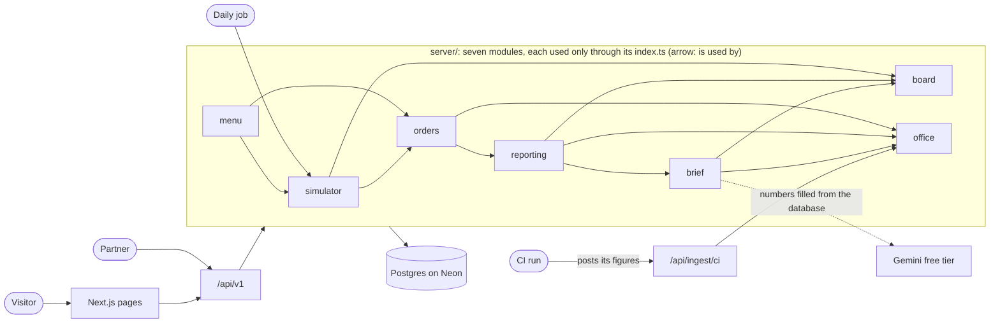

# Sally Mander's

**My General Motors résumé, running.** Each claim on the résumé has a small working twin here, and
the proof page sets them side by side, with every figure counted live or posted by the CI run that
measured it: **[the résumé, running](https://sally-manders-coffee.vercel.app/shop/office)**.

The demo is a coffee shop in South Austin that never closes, because it doesn't exist. You can order
from it (orders are pretend and free), and a simulator keeps the counter busy around the clock, so
there's always real traffic for the software to handle.

## Each claim, and where its evidence is

| # | Résumé claim | The twin here | Evidence | State |
| --- | --- | --- | --- | --- |
| 01 | Self-service tools across 30 plants | A versioned, documented API the shop itself orders through | [`server/api/v1.ts`](server/api/v1.ts), [`/docs`](https://sally-manders-coffee.vercel.app/shop/docs) | Running |
| 02 | Server-side Excel for 20K+ rows, no-op detection | A streamed .xlsx export with keyset paging that answers "Nothing changed" to a repeat | [`server/reporting/export/`](server/reporting/export/) | Running |
| 03 | Nightly load suite, p95 cut | A load test in CI with p95 per endpoint, before and after a fix | [`load/shop.jmx`](load/shop.jmx), [`scripts/ci/load-facts.mjs`](scripts/ci/load-facts.mjs), [decision 0006](docs/decisions/0006-load-test-through-neons-proxy.md) | Running |
| 04 | Microservices to AKS with Helm and Argo CD | An image, a Helm chart and an Argo CD app synced into a throwaway cluster in CI | [`Dockerfile`](Dockerfile), [`deploy/`](deploy/), [`scripts/ci/cluster-facts.mjs`](scripts/ci/cluster-facts.mjs), [decision 0008](docs/decisions/0008-the-shop-on-kubernetes.md) | Running |
| 05 | Re-architecture into 12-factor services | Seven domain modules behind a lint boundary rule, and a twelve-factor audit | [`eslint-rules/boundaries.mjs`](eslint-rules/boundaries.mjs), [decision 0004](docs/decisions/0004-domain-modules.md) | Running |
| 06 | Supply-chain hardening, >80% coverage | CodeQL, Dependabot, npm audit and a coverage bar (lines ≥ 90%, branches ≥ 80%) | [`.github/workflows/`](.github/workflows/), [`scripts/ci/coverage-bar.mjs`](scripts/ci/coverage-bar.mjs) | Running |
| 07 | A production LLM assistant | A model-drafted morning brief whose guard turns back any number the model wrote | [`server/brief/`](server/brief/), [decision 0005](docs/decisions/0005-the-brief-and-its-guard.md) | Running |
| 08 | Automated 2D-barcode validation | Every printed check's barcode read back from the screenshot's pixels | [`lib/code128.ts`](lib/code128.ts), [`e2e/barcode.spec.ts`](e2e/barcode.spec.ts) | Running |
| 09 | 100+ automated UI tests in CI | A Playwright suite, counted by CI | [`e2e/`](e2e/) | Running |
| 10 | Regression baselines cut verification 35% | Visual baselines on a stopped clock, and a release gate | [`e2e/visual.spec.ts`](e2e/visual.spec.ts), [`scripts/ci/release-gate.mjs`](scripts/ci/release-gate.mjs) | Running |
| 11 | Zero-downtime releases | Checks, expand-only migrations, deploy, then a smoke test and an uptime probe | [`scripts/ci/expand-only.mjs`](scripts/ci/expand-only.mjs), [`scripts/deploy/migrate.mjs`](scripts/deploy/migrate.mjs), [`.github/workflows/uptime.yml`](.github/workflows/uptime.yml), [decision 0007](docs/decisions/0007-zero-downtime-deploys.md) | Running |

The same report is in the API as `/api/v1/engineering`, and [`server/office/claims.ts`](server/office/claims.ts)
quotes each bullet word for word (a test holds every quote to the résumé's text).

## How it fits together



Next.js (App Router) and TypeScript on Vercel, Postgres on Neon through Drizzle, zod at every
boundary. The seven domain modules (menu, simulator, orders, reporting, brief, office, board) sit on a
shared `platform/` and `lib/`, and a lint rule keeps each to the modules it may use
([decision 0004](docs/decisions/0004-domain-modules.md)). Decisions worth explaining are in
[`docs/decisions/`](docs/decisions/).

## Working on it

Node 24 or later.

```bash
npm ci
npm run dev      # http://localhost:3000
npm run check    # typecheck, lint, tests
```

Without `DATABASE_URL`, development runs on a local Postgres (PGlite, in `.pglite/`) seeded with
a week of simulated days, so a fresh clone needs no setup. With a real database:

```bash
cp .env.example .env.local   # DATABASE_URL, CRON_SECRET, IP_HASH_SALT
npm run db:migrate
npm run sim:backfill -- --days 28
```

In production, `/api/cron/simulate` runs once a day (`vercel.json`) and writes today and tomorrow
if either is missing; it refuses any request without `Authorization: Bearer $CRON_SECRET`.

Dependencies are pinned to exact versions and installed with scripts disabled (`.npmrc`), and CI
verifies their registry signatures on every run.

## Viewing the mockups

They load sibling scripts, so serve the folder rather than opening a file:

```bash
python -m http.server 5178 --bind 127.0.0.1 --directory design/mockups
```

Then open http://localhost:5178/.
